<picture>
  <source media="(prefers-color-scheme: dark)" srcset="./assets/hero-dark.svg" />
  
</picture>

<div align="center">


<a href="https://github.com/marajanim?tab=followers"></a>

</div>

<br />

### 01 — About

I craft modern web applications with seamless animations and solid backend architecture.

- 🔭 Working on **Next.js, React, Vite** and **WordPress plugin development**
- 🎨 Focused on **pixel-perfect UI, glassmorphism** and **complex CSS animations**
- 🌱 Learning deeper **backend architecture & system design**
- 💬 Ask me about **frontend optimization, responsive design** and **UI engineering**

```ts
const maraj = {
  role: "Full-Stack Web Developer",
  frontend: ["Next.js", "React", "Vite"],
  backend: ["PHP", "Node.js", "WordPress"],
  focus: "Pixel-perfect UI & motion",
  learning: "System design",
};
```

<br />

### 02 — Stack

<div align="center">

<picture><source media="(prefers-color-scheme: dark)" srcset="https://skillicons.dev/icons?i=nextjs&theme=dark" /></picture>
<picture><source media="(prefers-color-scheme: dark)" srcset="https://skillicons.dev/icons?i=react&theme=dark" /></picture>
<picture><source media="(prefers-color-scheme: dark)" srcset="https://skillicons.dev/icons?i=vite&theme=dark" /></picture>
<picture><source media="(prefers-color-scheme: dark)" srcset="https://skillicons.dev/icons?i=js&theme=dark" /></picture>
<picture><source media="(prefers-color-scheme: dark)" srcset="https://skillicons.dev/icons?i=ts&theme=dark" /></picture>
<picture><source media="(prefers-color-scheme: dark)" srcset="https://skillicons.dev/icons?i=html&theme=dark" /></picture>
<picture><source media="(prefers-color-scheme: dark)" srcset="https://skillicons.dev/icons?i=css&theme=dark" /></picture>
<picture><source media="(prefers-color-scheme: dark)" srcset="https://skillicons.dev/icons?i=php&theme=dark" /></picture>
<picture><source media="(prefers-color-scheme: dark)" srcset="https://skillicons.dev/icons?i=wordpress&theme=dark" /></picture>
<picture><source media="(prefers-color-scheme: dark)" srcset="https://skillicons.dev/icons?i=nodejs&theme=dark" /></picture>
<picture><source media="(prefers-color-scheme: dark)" srcset="https://skillicons.dev/icons?i=git&theme=dark" /></picture>
<picture><source media="(prefers-color-scheme: dark)" srcset="https://skillicons.dev/icons?i=github&theme=dark" /></picture>
<picture><source media="(prefers-color-scheme: dark)" srcset="https://skillicons.dev/icons?i=vscode&theme=dark" /></picture>
<picture><source media="(prefers-color-scheme: dark)" srcset="https://skillicons.dev/icons?i=figma&theme=dark" /></picture>

</div>

<br />

### 03 — Numbers

<div align="center">

<picture>
  <source media="(prefers-color-scheme: dark)" srcset="https://github-readme-stats-eight-theta.vercel.app/api?username=marajanim&show_icons=true&theme=tokyonight&hide_border=true&bg_color=0A0A0F&title_color=F5F3FF&icon_color=A855F7&text_color=9CA3AF&ring_color=A855F7&card_width=420" />
  
</picture>
<picture>
  <source media="(prefers-color-scheme: dark)" srcset="https://github-readme-stats-eight-theta.vercel.app/api/top-langs/?username=marajanim&layout=compact&theme=tokyonight&hide_border=true&bg_color=0A0A0F&title_color=F5F3FF&text_color=9CA3AF&card_width=320" />
  
</picture>

<picture>
  <source media="(prefers-color-scheme: dark)" srcset="https://github-readme-streak-stats.herokuapp.com/?user=marajanim&theme=tokyonight&hide_border=true&background=0A0A0F&ring=A855F7&fire=EC4899&currStreakLabel=F5F3FF&currStreakNum=F5F3FF&sideNums=F5F3FF&sideLabels=9CA3AF&dates=6B7280&stroke=27272A" />
  
</picture>

<picture>
  <source media="(prefers-color-scheme: dark)" srcset="https://raw.githubusercontent.com/marajanim/marajanim/output/snake-dark.svg" />
  
</picture>

</div>

<br />

<picture>
  <source media="(prefers-color-scheme: dark)" srcset="./assets/footer-dark.svg" />
  
</picture>
